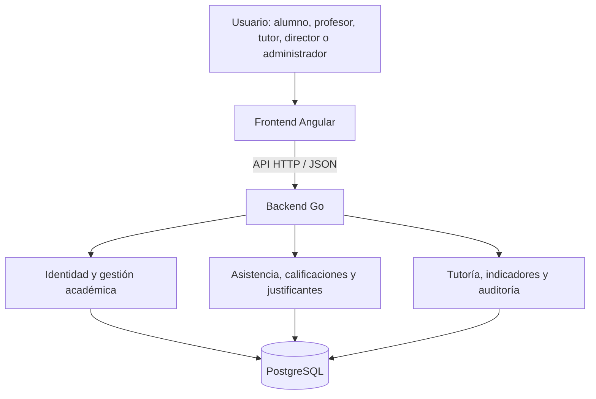

# 🎓 EDUTRAK

### Plataforma web de seguimiento académico y acompañamiento tutorial

**Universidad Tecnológica de Torreón · Ingeniería en Desarrollo y Gestión de Software**  
**Proyecto académico · Desarrollo Web Profesional**

**[Consultar prototipos en Figma](https://www.figma.com/design/6XQ9NdLBIaU6ncl1KT32LF/EDUTRAK?node-id=0-1)** · **[Frontend](https://github.com/EDUTRAKMX/EDUTRAK_FRONTEND)** · **[Backend](https://github.com/EDUTRAKMX/EDUTRAK_BACKEND)**

> **Estado del proyecto.** EDUTRAK es una propuesta académica en proceso de desarrollo. Las pantallas y el modelo de datos descritos son diseños y especificaciones; su presencia en este README **no implica que todas las funcionalidades ya estén implementadas**. No es una plataforma oficial desplegada por la UTT.

## 1. ¿Qué es EDUTRAK?

**EDUTRAK** es una plataforma web orientada a centralizar información de **asistencia, retardos, faltas, calificaciones, justificantes y seguimiento tutorial**. Busca proporcionar trazabilidad a los procesos académicos, simplificar el registro de asistencia y facilitar que docentes, tutores y alumnos consulten información relevante según su rol.

El sistema se diseña para operar mediante **QR dinámico** como mecanismo principal del pase de lista, **NFC** cuando el dispositivo lo permita y **registro manual** como alternativa. Sus indicadores apoyan la toma de decisiones humanas; no emiten diagnósticos personales ni determinaciones automáticas de reprobación.

## 2. Problema identificado

En el contexto académico, la información sobre asistencia y desempeño puede quedar distribuida entre profesores y procesos administrativos. Esto genera dificultades para:

- Consultar un historial consistente de faltas, retardos y calificaciones.
- Identificar oportunamente patrones de inasistencia o cambios de rendimiento.
- Reducir el tiempo de pase de lista sin sacrificar controles contra registros fraudulentos.
- Dar seguimiento verificable a solicitudes de justificación y acciones tutoriales.
- Proteger los expedientes académicos mediante permisos y trazabilidad.

**EDUTRAK propone un punto de consulta y operación común**, evitando que la falta de información consolidada impida el acompañamiento oportuno.

## 3. Objetivo general

Desarrollar una plataforma web de seguimiento académico y acompañamiento tutorial que centralice las calificaciones y la asistencia; permita capturar asistencia por QR dinámico, NFC opcional y alternativa manual con validación de red; gestione solicitudes de justificación con evidencia; y ofrezca indicadores explicables para el seguimiento académico.

### Objetivos específicos

1. Digitalizar sesiones de asistencia con verificación de identidad, grupo y condiciones de registro.
2. Ofrecer al alumno consulta de materias, horarios, calificaciones, faltas y retardos.
3. Gestionar justificaciones a través del flujo **Alumno → Tutor → Profesor**.
4. Proporcionar al Tutor seguimiento con observaciones, acuerdos, alertas e historial.
5. Aplicar acceso diferenciado por roles y registro de operaciones sensibles.
6. Construir una solución mantenible, separando la interfaz, el dominio y la persistencia.

## 4. Roles y responsabilidades funcionales

| Rol | Funciones previstas |
| --- | --- |
| **Administrador** | Soporte de cuentas institucionales y restablecimiento de contraseñas; sin acceso indiscriminado a expedientes. |
| **Director de Carrera** | Gestionar periodos, grupos, asignaciones de profesores, tutores, materias y horarios; consultar indicadores generales. |
| **Profesor** | Consultar grupos y materias, iniciar sesiones de asistencia, registrar QR/NFC/manual, capturar notas y resolver justificantes remitidos. |
| **Tutor** | Dar seguimiento a alumnos asignados, revisar asistencia y calificaciones, documentar acuerdos y revisar justificantes antes de remitirlos. |
| **Alumno** | Consultar su información, escanear QR desde su cuenta y solicitar justificantes con evidencia. |

## 5. Alcance del sistema

| Módulo | Alcance previsto |
| --- | --- |
| **Identidad y acceso** | Cuentas institucionales, autenticación, permisos, sesiones y contraseñas. |
| **Gestión académica** | Periodos, carreras, grupos, materias, inscripciones, asignaciones docentes y horarios. |
| **Asistencia** | Sesiones, QR dinámico, captura manual, NFC opcional, retardos y correcciones. |
| **Calificaciones** | Captura por unidad, consulta, promedios y clasificación por competencias. |
| **Justificantes** | Solicitud, evidencia privada, revisión del Tutor y decisión final del Profesor. |
| **Seguimiento tutorial** | Observaciones, acuerdos, acciones y registro de seguimiento. |
| **Analítica y alertas** | Indicadores verificables de asistencia y desempeño; alertas explicables. |
| **Auditoría** | Trazabilidad de cambios y operaciones sensibles. |

### Prioridades del MVP

Se priorizan **autenticación y roles, operación académica básica, asistencia QR/manual, portal del Alumno, calificaciones, justificantes y dashboard básico del Tutor**. El registro NFC y la analítica ampliada se contemplan como extensiones posteriores a la estabilización del flujo principal.

## 6. Reglas de negocio relevantes

| Regla | Definición del proyecto |
| --- | --- |
| Matrícula | Identificador institucional de **8 dígitos**. |
| Correo institucional | Formato `matricula@uttcampus.edu.mx`. |
| Notas | Valores decimales entre **0.00 y 100.00**, conservando el valor registrado. |
| Clasificación | **NA**: menor a 80; **SA**: 80 a menos de 90; **DE**: 90 a menos de 100; **AU**: exactamente 100. Sin redondear para clasificar. |
| Retardos | Umbral inicial de **15 minutos**, configurable por el Profesor. |
| Equivalencia | Estándar de **3 retardos = 1 falta**, configurable según las reglas de clase. |
| QR | El Profesor muestra un QR dinámico; el Alumno autenticado y correctamente inscrito registra su propio pase. |
| Red institucional | Validación adicional de red autorizada, con controles en el servidor; la IP por sí sola no prueba la presencia física. |
| Evidencias | PDF, JPG, JPEG y PNG de **hasta 10 MB por archivo**; acceso restringido por rol. |

## 7. Arquitectura y tecnologías

Se acordaron dos repositorios independientes: uno para **Angular** y otro para **Go**. El backend se diseña como un **monolito modular con arquitectura hexagonal por módulo**, mientras que el frontend seguirá una organización **por funcionalidades (feature-based)**. La persistencia se plantea en **PostgreSQL**.

### Decisiones de arquitectura

- **Frontend:** Angular, TypeScript, componentes reutilizables, rutas por rol, formularios reactivos y diseño responsive.
- **Backend:** Go, monolito modular con `domain`, `application`, `ports` y `adapters` por módulo.
- **Base de datos:** PostgreSQL, relaciones, restricciones, transacciones y migraciones versionadas.
- **Gestión:** Scrum ligero, tablero Jira y revisión incremental.
- **Calidad prevista:** pruebas unitarias, pruebas de integración y validaciones automáticas mediante GitHub Actions, una vez configuradas.

### Diseño UX/UI y prototipos

El diseño se documenta en **Figma**, con vistas para los distintos roles, estados de asistencia y adaptaciones para escritorio y móvil. La guía visual propuesta usa **Inter**, color primario `#029A7B`, fondo `#F6F8F8`, texto `#17201F`, superficie blanca y bordes `#D9E3E0`.

📐 **[Abrir prototipos y sistema de diseño de EDUTRAK](https://www.figma.com/design/6XQ9NdLBIaU6ncl1KT32LF/EDUTRAK?node-id=0-1)**

## 8. Repositorios de esta organización

| Repositorio | Responsabilidad | Documentación específica |
| --- | --- | --- |
| **[EDUTRAK_FRONTEND](https://github.com/EDUTRAKMX/EDUTRAK_FRONTEND)** | Interfaz Angular, navegación por rol, formularios, experiencia responsive e integración con API. | `README.md` del repositorio. |
| **[EDUTRAK_BACKEND](https://github.com/EDUTRAKMX/EDUTRAK_BACKEND)** | API Go, casos de uso, reglas de negocio, persistencia PostgreSQL, seguridad y pruebas. | `README.md` del repositorio. |

Los repositorios se mantienen separados para permitir trabajo independiente y contratos explícitos entre frontend y backend.

## 9. Colaboración y control de versiones

Se adopta **GitHub Flow** como estándar de trabajo propuesto:

- `main`: rama principal; integración mediante Pull Request.
- `feat/<modulo>-<tema>`: funcionalidad nueva, por ejemplo `feat/attendance-qr`.
- `fix/<modulo>-<tema>`: corrección de errores.
- `docs/<tema>`: documentación.
- `chore/<tema>`: tareas de mantenimiento.
- Commits con **Conventional Commits**, por ejemplo `feat(grades): add unit classification`.
- Pull Requests con descripción, relación con requisito/tarea, pruebas, evidencia visual cuando aplique, riesgos y revisión por otro integrante.
- Preferencia por **Squash Merge** una vez aprobadas las revisiones y validaciones configuradas.

> La aplicación efectiva de reglas de protección y los workflows de CI deben comprobarse en la configuración real de cada repositorio; aquí se documentan los estándares acordados.

## 10. Pruebas y calidad (estrategia prevista)

| Área | Pruebas propuestas |
| --- | --- |
| Go | Casos de uso, clasificación de notas, límites, permisos, registros duplicados y estados de justificantes. |
| Angular | Componentes, servicios HTTP, guards, formularios, errores y navegación. |
| PostgreSQL | Integridad referencial, unicidad, restricciones y transacciones en entorno aislado. |
| Flujo completo | Escenarios de QR/manual, calificaciones y justificaciones en etapas posteriores. |

Metas internas **sugeridas**, no requisitos de la rúbrica ni resultados obtenidos: **80 %** de cobertura en reglas críticas de Go y **70 %** en servicios y lógica relevante de Angular. Se planea ejecutar validaciones mediante **GitHub Actions** al abrir o actualizar Pull Requests.

## 11. Organización académica y avances

### Unidad 1 — Análisis y diseño

Problemática, justificación, objetivos, alcance, MVP, requisitos funcionales y no funcionales, riesgos, equipo, cronograma, arquitectura, propuesta de base de datos, patrones, prototipos y validaciones.

### Unidad 2 — Documentación técnica y colaboración

Maquetado y prototipado, Git y repositorio remoto, estrategia de ramas/PR, diagramas de arquitectura y casos de uso, **DER y diccionario de datos**, y README. Se añadieron como buenas prácticas complementarias la estructura del frontend, pruebas automatizadas y CI.

### Estado de entrega

- **Documentado:** planteamiento, requisitos, propuesta de arquitectura, reglas, modelo de datos y flujos UX/UI.
- **En desarrollo / por verificar:** código ejecutable, migraciones aplicadas, casos de prueba reales, workflows de CI, PR revisados e integración extremo a extremo.
- **No se publica:** información académica real, credenciales, tokens, evidencias privadas ni datos personales de alumnos.

## 12. Equipo de trabajo

| Integrante | Responsabilidad principal acordada |
| --- | --- |
| **Jaret Eduardo González Carrasco** | Líder del proyecto, arquitectura, backend y seguridad. |
| **Juan Pablo González Juárez** | Integración técnica y módulo de asistencia QR/NFC. |
| **Daniela Cabello González** | Frontend, UX/UI y análisis de procesos. |
| **Ernesto Herrera Martínez** | Datos, analítica, calidad y pruebas. |

**Asesoría académica:** MCC. Jesús del Toro Robledo.  
**Programa:** Ingeniería en Desarrollo y Gestión de Software · Universidad Tecnológica de Torreón.

---

**EDUTRAK — Seguimiento académico claro, trazable y orientado a las personas.**

*Proyecto académico; arquitectura y funcionalidades sujetas a desarrollo, pruebas y validación.*

