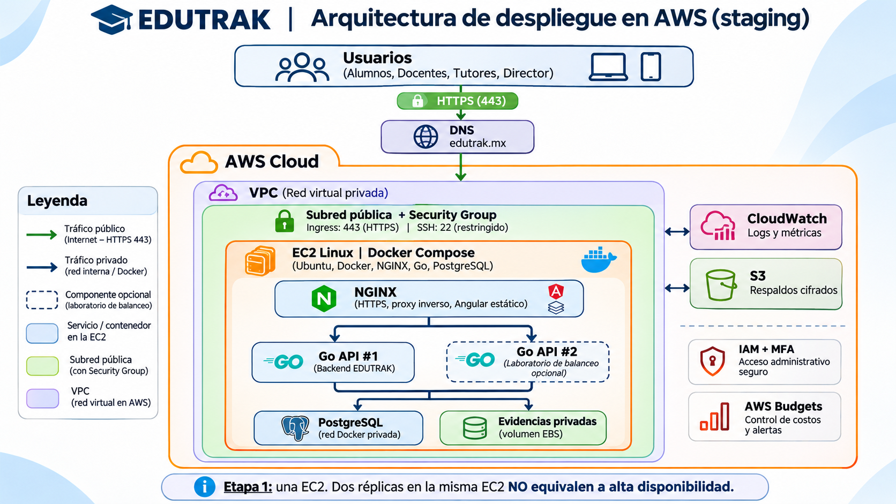

# EDUTRAK — Arquitectura de despliegue en AWS

**Propuesta técnica para staging | EDUTRAKMX**

> **Estado:** diseño conceptual propuesto, pendiente de aprobación y aprovisionamiento. Este documento **no** acredita que la infraestructura esté desplegada.

| Dato | Detalle |
|---|---|
| Proyecto | EDUTRAK — Plataforma de Seguimiento Académico y Acompañamiento Tutorial |
| Entregable | Propuesta de arquitectura cloud para staging del MVP |
| Referencia | Jira **ED-17** · **Unidad 3** |
| Responsable de arquitectura | Jaret Eduardo González Carrasco |
| Versión | 1.0 |
| Fecha | 17 de noviembre de 2026 |
| Plataforma | AWS EC2, Docker Compose, NGINX, Angular, Go y PostgreSQL |

El propósito es proponer un **staging económico**, con seguridad por capas y un laboratorio opcional de balanceo NGINX. Se recomienda comenzar con una sola instancia EC2. Dos réplicas de Go en esa misma instancia permiten practicar distribución de solicitudes, pero **no equivalen a alta disponibilidad**.



*Figura 1. Diagrama conceptual de infraestructura AWS. El dominio `edutrak.mx` es ilustrativo y no se presenta como registrado. El segundo contenedor Go corresponde a un laboratorio opcional.*

---

## 1. Vista general de la solución

Se recomienda comenzar con **una instancia de staging** y una red interna de Docker. El diagrama anterior también representa los componentes transversales y el laboratorio opcional de balanceo.

### 1.1 Componentes y función

| Capa o servicio | Responsabilidad principal |
|---|---|
| Usuarios y DNS | Navegadores de alumnos, profesores, tutores y director. Dominio ilustrativo: `edutrak.mx` (no registrado). |
| VPC y subred pública | Segmento de red AWS para la EC2; salida a Internet mediante Internet Gateway y reglas del Security Group. |
| EC2 Linux y Docker Compose | Aloja el staging. Inicio con una API Go; segunda réplica únicamente para laboratorio. |
| NGINX y Angular | Sirve la SPA compilada, termina HTTPS, funciona como proxy inverso y distribuye `/api` hacia Go. |
| Go y PostgreSQL | Lógica del MVP y datos académicos; la base de datos no publica el puerto `5432`. |
| Volúmenes EBS y S3 | Persistencia privada para datos y evidencias; S3 para copias de seguridad cifradas. |
| IAM, CloudWatch y Budgets | Control administrativo, métricas y alertas de costo. |

**Principio de diseño:** mantener simple el despliegue para la demostración en clase y presentar el balanceo y la alta disponibilidad como etapas separadas.

## 2. Topología de red y seguridad

Se propone situar la EC2 en una **subred pública** para reducir costos. PostgreSQL y los contenedores Go permanecen privados detrás de NGINX.

### 2.1 Flujo de una solicitud

1. El usuario resuelve el dominio configurado; DNS apunta a la IP pública de la EC2 o a un registro equivalente.
2. El tráfico HTTPS entra mediante Internet Gateway y el Security Group permite TCP/443.
3. NGINX entrega los archivos estáticos de Angular y envía `/api/` al contenedor Go mediante la red Docker.
4. La API consulta PostgreSQL por su nombre de servicio interno, nunca mediante una IP pública.
5. Si el usuario solicita una evidencia, Go verifica sus permisos antes de acceder al almacenamiento privado.

### 2.2 Reglas de exposición propuestas

| Recurso | Entrada permitida | Condición |
|---|---|---|
| NGINX / EC2 | TCP 443 desde Internet | Obligatorio para HTTPS. |
| NGINX / EC2 | TCP 80 desde Internet | Solo para redirección a HTTPS y validación de certificados. |
| Administración | TCP 22 desde una IP autorizada, o SSM | No exponer SSH globalmente; preferir Session Manager cuando sea viable. |
| API Go | Ningún puerto público | Acceso únicamente desde NGINX mediante la red Docker. |
| PostgreSQL `5432` | Ningún puerto público | Solo desde el backend por la red Docker; sin publicar el puerto en AWS. |
| Archivos de evidencia | Ninguna URL pública | Descarga por un endpoint autenticado y autorizado. |

**Validación del QR institucional:** la instancia AWS no está físicamente dentro de la universidad. La API debe comprobar el origen real de las peticiones a través de NGINX y `TRUSTED_PROXIES`, contrastándolo con `ALLOWED_NETWORKS` (direcciones IP públicas de salida/NAT confirmadas por la universidad). No se deben aceptar direcciones IP enviadas en JSON ni confiar indiscriminadamente en `X-Forwarded-For`.

## 3. Servicios, contenedores y persistencia

La configuración del staging deberá partir del `Dockerfile` y del `docker-compose.yml` del backend ya implementados. No se propone publicar el entorno de pruebas sin ajustes de seguridad.

### 3.1 Contenedores y almacenamiento

| Servicio | Contenedor o montaje | Decisión de operación |
|---|---|---|
| NGINX | Proxy inverso frontal; puertos 80/443 | Sirve Angular estático, enruta `/api`, administra TLS y cabeceras. |
| Angular | Compilación estática en volumen o imagen NGINX | No necesita un proceso Node.js para servir el frontend compilado. |
| EDUTRAK Go | Contenedor `edutrak-api:8080` | JWT, RBAC y API. Una réplica inicial; dos réplicas opcionales para práctica. |
| PostgreSQL | Contenedor `db:5432` privado | Datos persistidos en un volumen EBS; migraciones controladas. |
| Evidencias | Volumen privado en EBS | `STORAGE_DIR` compartido entre las APIs, si hay dos contenedores en la misma EC2. |
| Respaldos | Archivos `pg_dump` y S3 privado | Cifrado, retención y pruebas de recuperación; no utilizar S3 como base de datos activa. |

### 3.2 Configuración necesaria, sin publicar secretos

- **`APP_ENV=production`:** exigir configuración segura; no reutilizar contraseñas ni secretos de ejemplo.
- **`JWT_SECRET` y `DB_PASSWORD`:** generar valores aleatorios. Preferir un gestor de secretos o parámetros protegidos con los permisos IAM mínimos necesarios.
- **`CORS_ALLOWED_ORIGINS`:** definir el origen HTTPS exacto del frontend, sin comodines.
- **`TRUSTED_PROXIES`:** confiar únicamente en la IP real de NGINX dentro de la red de contenedores, no en un rango privado amplio.
- **`ALLOWED_NETWORKS`:** usar direcciones IP o rangos públicos de la universidad confirmados por su responsable de red.
- **`STORAGE_DIR`:** usar una ruta privada, persistente, absoluta y con permisos restringidos.

**Persistencia:** base de datos, respaldos y archivos de `STORAGE_DIR` deben almacenarse fuera del sistema de archivos efímero de los contenedores. Recrear un contenedor no debe eliminar archivos ni tablas.

### 3.3 Integración con el repositorio

El equipo dispone de `Dockerfile`, `docker-compose.yml`, endpoint `/readyz`, migraciones, datos de demostración (*seed*) y documentación OpenAPI. Antes del despliegue es necesario comprobar que el frontend compilado, el proxy y las variables de entorno reales funcionan con un Compose de staging específicamente preparado para AWS.

## 4. Balanceador NGINX y escalabilidad

La práctica de balanceo puede realizarse **sin contratar un Application Load Balancer (ALB)**: se levantan dos contenedores Go en la misma EC2 y NGINX distribuye las solicitudes entre ellos.

### 4.1 Laboratorio: dos réplicas de Go en una EC2

| Paso | Qué se demuestra |
|---|---|
| API 1 + API 2 | Mismo binario Go, mismas migraciones y esquema, credenciales coherentes. |
| `upstream` de NGINX | Algoritmo *round-robin* por defecto o `least_conn`; distribución de `/api` entre las dos réplicas. |
| Salud y fallo de proceso | Detener una réplica y comprobar si las solicitudes nuevas llegan a la otra. |
| Observabilidad | Logs diferenciados por backend y métricas básicas de respuesta y errores. |

### 4.2 Fragmento didáctico de configuración NGINX

```nginx
upstream edutrak_api {
    least_conn;
    server api1:8080;
    server api2:8080;
}

location /api/ {
    proxy_pass http://edutrak_api;
    proxy_set_header Host $host;
    proxy_set_header X-Forwarded-For $remote_addr;
    proxy_set_header X-Forwarded-Proto $scheme;
}
```

Este fragmento es ilustrativo y debe completarse con TLS, configuración de Docker, tiempos de espera y tratamiento de fallos. La IP del proxy recibida por Go debe configurarse de forma estricta en `TRUSTED_PROXIES`.

### 4.3 Restricciones para la exposición

- **No es alta disponibilidad:** si falla la única EC2, dejan de funcionar ambas réplicas y la base de datos.
- **Límite de intentos:** si el control de login está en memoria por proceso, dos instancias no comparten el contador. Es aceptable como laboratorio, pero no debe suponerse seguridad equivalente a un limitador centralizado.
- **Archivos:** las dos APIs deben compartir `STORAGE_DIR` con permisos correctos.
- **Estado:** las réplicas deben validar JWT de la misma manera y utilizar la misma base de datos duradera.

### 4.4 Etapa opcional: balanceo administrado

Como laboratorio posterior podría utilizarse un ALB con dos EC2 en distintas zonas de disponibilidad y una estrategia de base de datos y almacenamiento compartidos. Esto incrementa los costos y **el ALB por sí solo no garantiza la disponibilidad de PostgreSQL**.

## 5. Seguridad, monitoreo y recuperación

La propuesta considera controles de seguridad aplicables a Linux, red, NGINX, TLS, SSH, auditoría y respaldos.

### 5.1 Controles operativos propuestos

| Área | Control y evidencia |
|---|---|
| Identidad AWS | MFA, IAM con privilegios mínimos, rol IAM de EC2; no utilizar la cuenta root como operación cotidiana. |
| Red | Security Group con 80/443, SSH restringido o SSM; documentar SG e Internet Gateway. |
| TLS | Certificado válido, redirección HTTP a HTTPS, renovación verificada y NGINX como único servicio expuesto. |
| API | CORS exacto, validación de entradas, JWT, límites, logs sanitizados y verificación de `/health` y `/readyz`. |
| BD y evidencias | PostgreSQL y evidencias privados, EBS cifrado, permisos mínimos y respaldos cifrados con retención. |
| CloudWatch | CPU, memoria mediante agente, disco, errores 5xx y logs de NGINX/Go según presupuesto. |
| Costos | AWS Budgets, alarmas de consumo, revisión de facturación y apagado de recursos de laboratorio al finalizar. |

### 5.2 Plan de copias de seguridad

1. Programar respaldos lógicos de PostgreSQL con `pg_dump` y copias de las evidencias; cifrar ambos y aplicar permisos IAM apropiados.
2. Guardar las copias **fuera de la EC2**, por ejemplo en un bucket S3 privado sin acceso público.
3. Definir retención de versiones y caducidad para controlar costos.
4. Probar una restauración real en un entorno aislado y registrar el tiempo y la consistencia.
5. Complementar las copias lógicas con instantáneas EBS cuando convenga; una instantánea sin coordinación no garantiza por sí sola una copia consistente de PostgreSQL.

**Privacidad:** los expedientes académicos y las evidencias de justificantes son información sensible. Para la demostración deben emplearse datos ficticios del *seed*. No publicar credenciales ni documentos personales reales.

## 6. Dimensionamiento, costos y créditos

Los importes de la propuesta son **estimaciones de referencia** para `us-east-1` (N. Virginia), Linux bajo demanda y 730 horas mensuales, calculadas para el documento del **17 de noviembre de 2026**. **No representan una cotización ni precios garantizados**; deben confirmarse en AWS antes de crear recursos.

### 6.1 Costos de referencia

| Componente | Escenario 2 GiB | Escenario 4 GiB |
|---|---:|---:|
| EC2 `t3.small` (2 vCPU / 2 GiB) | US$15.26/mes | — |
| EC2 `t3.medium` (2 vCPU / 4 GiB) | — | US$30.51/mes |
| EBS `gp3` de 30 GB | US$2.40 | US$2.40 |
| Una IPv4 pública | US$3.65 | US$3.65 |
| **Subtotal estimado** | **US$21.31/mes** | **US$36.56/mes** |
| S3, CloudWatch, transferencia, instantáneas e impuestos | Variable | Variable |

**Recomendación del documento:** empezar con `t3.small` solamente para una demostración de baja concurrencia, medir recursos y evaluar `t3.medium` si se requiere más memoria. Si se levantan dos réplicas Go y PostgreSQL en la misma EC2, 4 GiB proporcionan mayor margen. El modo T3 Unlimited puede originar cargos adicionales por CPU.

### 6.2 Créditos de bienvenida AWS

De acuerdo con las condiciones recogidas en el documento original (noviembre de 2026), AWS describe **US$100 de crédito al registro** para nuevos clientes elegibles y la posibilidad de obtener **hasta US$100 adicionales** mediante actividades. Estos montos y condiciones **deben verificarse con AWS** antes de crear recursos.

- Según la propuesta, el **Free plan** puede finalizar a los **seis meses o cuando se agoten los créditos**, lo que ocurra primero. No implica un servidor gratuito indefinidamente.
- En el Free plan, la cuenta y los recursos pueden cerrarse al terminar la vigencia. Antes del vencimiento, exportar los datos que se deban conservar o evaluar el cambio a **Paid plan**.
- Las alertas de AWS Budgets **no constituyen un límite estricto de gasto**.
- No activar NAT Gateway, ALB, RDS ni varias EC2 permanentemente sin un presupuesto individual para cada servicio.

### 6.3 Escenarios de uso

| Escenario | Objetivo | Elección |
|---|---|---|
| Staging académico | Demostración pública con acceso controlado | Una EC2, NGINX, Docker y PostgreSQL. |
| Práctica de balanceo | Distribuir carga y tolerar el fallo de un contenedor | Dos Go en la misma EC2, de forma temporal. |
| Laboratorio de alta disponibilidad | Practicar ALB y zonas de disponibilidad | Dos EC2, ALB y estrategia de datos, de forma temporal. |

## 7. Plan de despliegue por fases

El objetivo es definir una secuencia verificable, **no afirmar que los recursos ya se hayan creado**.

| Fase | Actividades | Evidencia esperada |
|---|---|---|
| 0 — Diseño | Elegir región, instancia, dominio, presupuesto; revisar Jira ED-17 y decisiones institucionales. | Diagrama, matriz de costos y lista de verificación aprobada. |
| 1 — Cuenta y red | MFA, IAM, Budgets, VPC/subred, Internet Gateway y Security Group restrictivo. | Capturas de IAM/SG sin secretos y presupuesto configurado. |
| 2 — Servidor | Crear EC2 y EBS cifrado, configurar SSH/SSM, parches, Docker y volúmenes privados. | Servidor seguro y base de datos sin exposición pública. |
| 3 — Aplicación | Configurar secretos, redes Docker, migraciones, PostgreSQL, Go, Angular y NGINX. | `/readyz` funcional, acceso de prueba desde el navegador y endpoints que responden. |
| 4 — TLS / red QR | DNS real, certificado, CORS, NGINX, `TRUSTED_PROXIES` y `ALLOWED_NETWORKS`. | HTTPS válido y verificación del origen real de la IP. |
| 5 — Pruebas | *Seed* ficticio, roles, QR, calificaciones, justificantes, tutorías, indicadores y alertas. | Capturas, logs y pruebas de extremo a extremo. |
| 6 — Operación | CloudWatch, respaldo/restauración, rotación de secretos, rollback y apagado del laboratorio. | Métricas, restauración comprobada y plan de reversión. |

### 7.1 Checklist previo a la presentación del staging

- [ ] Dominio real definido y certificado HTTPS válido, sin alertas del navegador.
- [ ] PostgreSQL privado y API no expuesta directamente a Internet.
- [ ] Secretos fuera de Git y variables de entorno verificadas.
- [ ] Flujos de Director, Tutor, Profesor y Alumno probados desde Angular.
- [ ] QR comprobado tanto desde una red permitida como desde una no permitida; política institucional confirmada.
- [ ] Copias de seguridad y plan de rollback documentados, usando datos ficticios.
- [ ] Presupuesto AWS, responsable de la cuenta y fecha de apagado o continuidad definidos.

## 8. Riesgos, decisiones y fuentes

La propuesta cubre la tarea **Jira ED-17** como diseño de arquitectura. **El aprovisionamiento de AWS y el despliegue no se presentan como ejecutados.**

### 8.1 Decisiones pendientes de validación

| Decisión | Propuesta actual o asunto pendiente |
|---|---|
| Dominio | `edutrak.mx` aparece solo como ejemplo; elegir o registrar el dominio real. |
| Instancia | Empezar por `t3.small` si es suficiente; evaluar `t3.medium` según perfiles de memoria y consumo. |
| Plataforma | Una EC2 con Docker Compose para staging; arquitectura multi-AZ futura solo como laboratorio. |
| QR institucional | Confirmar IP públicas/NAT y reglas `ALLOWED_NETWORKS` y `TRUSTED_PROXIES`. |
| Datos y archivos | Acordar respaldos, retención, privacidad, restauración y persistencia de `STORAGE_DIR`. |
| Reglas escolares | Validar umbrales de alertas, justificaciones y calificaciones antes de producción. |
| Disponibilidad | Definir si se requiere solo staging académico o tolerancia a fallos real. |

### 8.2 Evidencia propuesta para Jira ED-17

- Diagrama de infraestructura AWS con flujos públicos y privados, componentes y responsabilidades.
- Topología de red y reglas propuestas para Security Groups.
- Selección de EC2, estrategia de contenedores y almacenamiento persistente.
- Comparación de balanceo NGINX con servicios AWS multi-AZ.
- Estimación de costos y gestión de créditos.
- Plan de despliegue, pruebas, respaldos, recuperación y riesgos.

### 8.3 Fuentes oficiales citadas en el documento de origen

Fuentes utilizadas para elaborar la propuesta (noviembre de 2026; verificar sus condiciones vigentes):

1. [AWS — Instancias EC2 T3](https://aws.amazon.com/ec2/instance-types/t3/).
2. [AWS — Volúmenes EBS](https://aws.amazon.com/ebs/volume-types/).
3. [AWS — Precios de VPC / IPv4 pública](https://aws.amazon.com/vpc/pricing/).
4. [AWS — Free Tier y planes gratuitos](https://docs.aws.amazon.com/awsaccountbilling/latest/aboutv2/free-tier-plans.html).
5. [AWS — Grupos de seguridad VPC](https://docs.aws.amazon.com/vpc/latest/userguide/vpc-security-groups.html).
6. [AWS — Budgets](https://aws.amazon.com/aws-cost-management/aws-budgets/).

## 9. Conclusión

Para la **Unidad 3** se propone diseñar y documentar primero una única EC2 segura con NGINX y Docker, ejecutando frontend Angular, API Go y PostgreSQL privado. El laboratorio de balanceo puede demostrarse con dos réplicas Go alojadas en esa misma máquina.

La **alta disponibilidad real** requiere componentes, persistencia y presupuesto adicionales. La implementación deberá aprobarse, aprovisionarse, probarse y documentarse antes de considerarse operativa.

---

**Documento adaptado a Markdown a partir de `EDUTRAK_Arquitectura_Cloud_AWS.pdf`, versión 1.0 (17/11/2026).** Se conserva el carácter de *propuesta técnica*; la disponibilidad, los costos y las condiciones de los servicios AWS están sujetos a verificación al momento de implementarlos.
